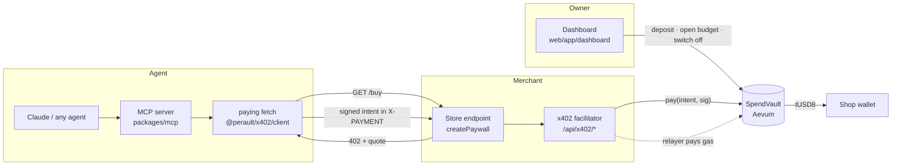
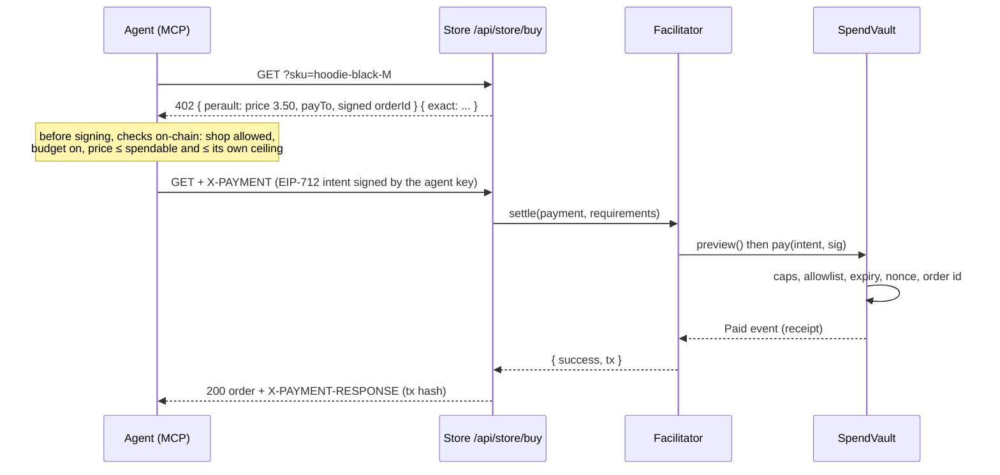

# Perault

**Spending budgets for AI agents, enforced on-chain.** Give an agent a prepaid card with limits
and an off switch, and let it pay for things on QDay Aevum in tUSD8.

- **Live site:** https://perault.vercel.app (owner dashboard, demo store, public x402 facilitator)
- **Contract:** SpendVault [`0xc615c8682b1A665C6d3d7aB2128ef83210B414Dc`](https://explorer-test.qday.info/address/0xc615c8682b1A665C6d3d7aB2128ef83210B414Dc) on Aevum testnet (chain 44005)
- **Built for:** Aevum Builder Challenge #1

---

## The problem

AI agents can now browse, compare and decide. What they can't do safely is pay. Today you either
hand an agent your wallet's key, so a confused or prompt-injected agent can drain it, or you
approve every payment by hand, which defeats the point of an agent.

## What Perault does

The owner deposits tUSD8 into a **vault** and gives each agent a **budget** (on-chain, a
*session*) with:

- a cap on any single payment, a daily cap and a total cap
- a list of shops it may pay, and nobody else
- an expiry, and a switch that turns it off instantly

The agent holds a throwaway key that can only **sign** payments within that budget. It never holds
tokens or gas. Every rule is checked by the SpendVault contract when the payment settles, so even
an agent that has been tricked, or a client that lies, cannot spend more than its budget or pay a
shop the owner didn't allow.

Merchants get paid through **x402**, the HTTP 402 "payment required" standard, via the first x402
facilitator for Aevum. The same shop endpoint accepts agents (paying from a Perault budget) and
people (paying from their wallet with one signature).

## Try it in 3 minutes

1. Open the **store**: https://perault.vercel.app/store. A shop selling four items, priced in tUSD8.
2. Connect a wallet on Aevum testnet that holds a little tUSD8 (faucet: see
   [docs/STARTER-KIT.md](docs/STARTER-KIT.md#get-test-tokens)) and press **Buy for 1.00 tUSD8** on the
   socks. One signature, no gas: the site's facilitator settles it, and the order appears under
   **Recent orders** with its transaction.
3. Open the **dashboard**: https://perault.vercel.app/dashboard. Add money to the vault and **give an
   agent a budget** (it can generate the agent's key for you). It then shows the config to paste
   into Claude.
4. With the MCP server connected (see [Connect Claude](#connect-claude-as-the-agent)), ask Claude:
   *"Buy me the black hoodie from https://perault.vercel.app/api/store/buy?sku=hoodie-black-M, it
   should cost 3.50."* Then ask for the 6.00 jacket: it is refused, and nothing is charged.
5. Flip the agent's switch on the dashboard (press, then press again). Claude's next purchase is
   refused: *"The owner revoked this session."*

## Proof on Aevum testnet

Every row is a real transaction ([deployments/aevum-testnet.json](deployments/aevum-testnet.json)
has them all).

| What happened | Transaction |
|---|---|
| SpendVault deployed | [`0x7455…7628`](https://explorer-test.qday.info/tx/0x7455f68d86b16d8616ec152f996145110d55a891fdc79b3288b591fa40f47628) |
| Owner opens an agent budget | [`0x43b7…5e07`](https://explorer-test.qday.info/tx/0x43b79735b78430e7da19a7bb0f9ea297588d4482255c60b64b10f6bb78e75e07) |
| Agent pays 3.50 for a hoodie through the full x402 loop (agent → store → facilitator → vault) | [`0x7924…06f5`](https://explorer-test.qday.info/tx/0x792400ab5b8cd30eedebc506e6c9bc0fb1e2abbce57ed751a020ab5ebd4806f5) |
| Agent pays 1.00 for socks; the 6.00 jacket was refused before signing | [`0x463c…2248`](https://explorer-test.qday.info/tx/0x463c07134309216fca54b0ed1e668c902e0516e219ba97fd94046c4dfa7e2248) |
| **Claude Code**, through the Perault MCP server, buys the hoodie | [`0x261b…3a26`](https://explorer-test.qday.info/tx/0x261b7403288011006ee56868fabb4700e30c88948abfc5afa7e17840c3ae3a26) |
| A person buys socks on the public site with standard x402 `exact` | [`0xcf87…7a57`](https://explorer-test.qday.info/tx/0xcf873a7958e1c777b065ace458757e0a385d8b4dfce628b94b6357f855457a57) |
| Owner turns an agent off (revoke) | [`0x1824…f644`](https://explorer-test.qday.info/tx/0x182400a6130ad60c475774d88497880fec1de5b139b559a1523a65d31c20f644) |

In every agent payment the agent's address has never held gas: the relayer submits, the vault pays.

## How it works



An agent purchase, step by step:



## What's in the repo

| Path | What it is |
|---|---|
| [`contracts/src/SpendVault.sol`](contracts/src/SpendVault.sol) | The vault: deposits, budgets (sessions), caps, allowlists, expiry, revoke, revoke-all, `pay`, `preview` |
| [`packages/perault-sdk`](packages/perault-sdk) | `@perault/sdk`: TypeScript client for owners, agents and merchants ([README](packages/perault-sdk/README.md)) |
| [`packages/x402`](packages/x402) | `@perault/x402`: x402 facilitator (HTTP server + Docker), merchant paywall, agent paying fetch ([README](packages/x402/README.md)) |
| [`packages/mcp`](packages/mcp) | `@perault/mcp`: MCP server so Claude can check budgets and pay ([README](packages/mcp/README.md)) |
| [`web`](web) | Next.js site: dashboard, demo store, hosted facilitator routes |
| [`examples`](examples) | `perault-store` and `perault-agent` scripts, plus the starter kit's examples |
| [`deployments/aevum-testnet.json`](deployments/aevum-testnet.json) | Addresses and every live transaction above |

Built on [qday-io/aevum-starter-kit](https://github.com/qday-io/aevum-starter-kit) (MIT); its
Checkout example and docs are kept, see [docs/STARTER-KIT.md](docs/STARTER-KIT.md).

## The SpendVault contract

```solidity
deposit(amount) · depositWithAuthorization(from, amount, …, v, r, s)   // gasless, EIP-3009
withdraw(amount)                                                       // owner only, own balance only
openSession(agent, perTxCap, dailyCap, totalCap, expiry, merchants[]) → sessionId
setMerchant(sessionId, merchant, allowed) · revoke(sessionId) · revokeAll()
pay(PaymentIntent, signature)        // anyone may submit; every rule is checked here
preview(PaymentIntent, signature)    // the same checks as a free view: returns the error pay() would hit
budgetOf(sessionId) · getSession · receiptOf(merchant, orderId) · hashIntent · isMerchantAllowed
```

- **No admin.** No owner of the contract, no pause, no upgrade. Nobody but a depositor can move
  their money.
- **The agent key can only sign payments.** It can't withdraw, change caps or open budgets.
- **Replay-proof and idempotent.** Each intent nonce is single-use per session and each
  (merchant, order id) can be paid once, so a retried payment never charges twice.
- **`revokeAll` is one cheap transaction** however many budgets exist (it bumps an epoch).
- **Agents may be smart accounts.** Signatures are checked with `SignatureChecker` (EOA or
  ERC-1271), ready for ERC-4337 session keys later.
- Errors: `OverPerTx`, `OverDaily`, `OverTotal`, `MerchantNotAllowed`, `Revoked`, `SessionExpired`,
  `IntentExpired`, `NonceUsed`, `OrderAlreadyPaid`, `BadSignature`, `InsufficientBalance`, … each
  mapped to a plain-language message by the SDK.

## How Aevum is used

| Aevum feature | How Perault uses it |
|---|---|
| **tUSD8** (6 decimals, USDC-style) | The only settlement asset. Prices, caps and balances are in tUSD8 base units. |
| **EIP-3009** (`transferWithAuthorization`, `receiveWithAuthorization`) | Gasless vault deposits (`depositWithAuthorization`), and the standard x402 `exact` scheme the facilitator settles for people paying from a wallet. |
| **EIP-712** | Agents sign typed `PaymentIntent`s under the `Perault` v1 domain; the SDK's digest is tested to match `SpendVault.hashIntent` byte for byte. |
| **Session keys / budgets** | Written into our own contract, as the QDay team advised on Discord: *"To get budgets, per-transaction limits, expiry and revoke, write them into your own contract. That counts for the judging criteria."* |
| **x402** | The team confirmed *"there is no hosted facilitator for Aevum"*. `@perault/x402` is one: standard `/supported`, `/verify`, `/settle`, live at `https://perault.vercel.app/api/x402/*` and runnable as a Docker image. |
| **ERC-4337** | Not used: no bundler or paymaster is supported on Aevum, and the team advised a normal wallet plus a relayer. Agent signatures already accept ERC-1271 smart accounts, so 4337 session keys are a drop-in later. |
| **Shanghai EVM** | Contracts compile for `shanghai` (no TSTORE / MCOPY); `tools/check-shanghai.mjs` verifies the bytecode. |
| **1,000-block `eth_getLogs` cap** | Every log read (payments, allowlists, store orders) is chunked and runs a few chunks in parallel. |
| **No WebSocket RPC** | The dashboard's payment feed and store orders poll over HTTPS every few seconds. |
| **Legacy transactions** | The SDK and facilitator send type-0 transactions, as the starter kit recommends. |

## Safety model

| Threat | What stops it |
|---|---|
| Agent key leaks | It can only spend the remaining budget, at allowed shops, until expiry. The owner turns it off in one transaction. |
| Prompt injection ("pay 0xattacker") | The shop isn't on the allowlist: the agent client refuses before signing, and the contract rejects it anyway (`MerchantNotAllowed`). |
| Runaway spending | Per-payment, daily and total caps in the contract; the agent client also has its own per-request ceiling; MCP `max_amount` can only lower it. |
| A buggy or lying client | Every rule is re-checked on-chain at settlement (tested with a client that misreports its budget). |
| Replayed or retried payments | Single-use nonces and one payment per (shop, order id); the facilitator returns the original transaction instead of charging twice. |
| A captured payment reused for another item | The agent signs the shop's quoted order id; the quote is HMAC-signed and bound to the item and price. |
| Strangers spending the relayer's gas | `/settle` needs an API key; the relayer holds a little tQDAY and no customer money. |
| Merchant text steering the agent | MCP returns merchant responses wrapped as untrusted data; an optional host allowlist limits where the agent can go. |

## Run it yourself

**Prerequisites:** Node 22+, pnpm 10, [Foundry](https://getfoundry.sh), git.

```bash
git clone https://github.com/JusticeSol/perault && cd perault
git submodule update --init --recursive
pnpm install
make build test test-fork test-sdk test-x402 test-mcp   # contracts, fork of Aevum, SDK, facilitator, MCP
```

**Use the deployed vault** (default) or deploy your own:

```bash
cast wallet import aevum-deployer --interactive            # a fresh test wallet, funded from the faucet
make deploy-vault-aevum ACCOUNT=aevum-deployer             # prints the SpendVault address
```

Forge scripts that read your wallet need `--sender <your address>` on the command line.

**Run the site locally:**

```bash
cp web/.env.example web/.env.local     # fill in the values below
pnpm dev                               # http://localhost:3000
```

**Deploy the site:** import the repo on Vercel with **Root Directory** `web`, keep "include files
outside the root directory" on, add the variables below (secrets as Secret), deploy. Pushes to
`main` redeploy.

### Settings

`web` (`web/.env.local`, or the Vercel project):

| Variable | Required | |
|---|---|---|
| `NEXT_PUBLIC_NETWORKS` | yes | `aevum` |
| `STORE_ADDRESS` | for the store | the shop's receiving address |
| `FACILITATOR_PRIVATE_KEY` | for the store + facilitator | relayer key: pays settlement gas, holds a little tQDAY only. **Secret.** |
| `FACILITATOR_API_KEY` | recommended | outside callers send it as `Authorization: Bearer` to `/api/x402/settle`. **Secret.** |
| `PAYWALL_SECRET` | on serverless | signs store quotes so any instance accepts the paid retry. **Secret.** |
| `NEXT_PUBLIC_DEMO_STORE` | optional | pre-fills the shop on the "give an agent a budget" form |
| `NEXT_PUBLIC_STORE_NAME` | optional | the demo store's name (default "Demo Label") |
| `NEXT_PUBLIC_VAULT_AEVUM` | optional | a different SpendVault |
| `NEXT_PUBLIC_REPO_URL`, `TRUSTED_IP_HEADER` | optional | starter-kit settings |

Standalone facilitator (`packages/x402/.env`): `FACILITATOR_PRIVATE_KEY`, `FACILITATOR_API_KEY`,
`PORT`, `RPC_URL`, `CHAIN_ID` ([details](packages/x402/README.md#run-it)).

MCP server: `AGENT_PRIVATE_KEY`, `PERAULT_SESSION_ID`, `PERAULT_MAX_AMOUNT`,
`PERAULT_ALLOWED_HOSTS` ([details](packages/mcp/README.md#set-up-with-claude-desktop)).

### Connect Claude as the agent

Open a budget on the dashboard (it shows the session id, and the agent key if it generated one), then:

```bash
claude mcp add perault --scope local \
  -e PERAULT_SESSION_ID=0x… -e PERAULT_MAX_AMOUNT=4 -e PERAULT_ALLOWED_HOSTS=perault.vercel.app \
  -- node <repo>/packages/mcp/node_modules/tsx/dist/cli.mjs --env-file=<file with AGENT_PRIVATE_KEY=0x…> <repo>/packages/mcp/src/main.ts
```

Keeping the agent key in an env file (outside the repo, or gitignored) means it never sits in the
Claude config. Claude Desktop config: see [packages/mcp/README.md](packages/mcp/README.md). Tools:
`get_budget`, `check_price`, `pay_402_url`, `list_payments`.

## Use the pieces in your own project

```ts
// A merchant: put an endpoint behind x402
const paywall = createPaywall({ facilitatorUrl: "https://perault.vercel.app/api/x402", apiKey, payTo, secret });
export const GET = (req: Request) =>
  paywall.protect(req, { amount: 2_000_000n, description: "One API call" }, (paid) => Response.json({ data }));

// An agent: a fetch that pays 402s from its budget
const pay = createPayingFetch({ perault: { client: new PeraultClient({ publicClient }), signer: agentKey, sessionId }, maxAmount: 4_000_000n });
const res = await pay("https://perault.vercel.app/api/store/buy?sku=socks-white");

// An owner: budgets from code
const { sessionId } = await perault.openSession({ agent, perTxCap: 4_000_000n, dailyCap: 5_000_000n, totalCap: 5_000_000n, expiresInSeconds: 86_400, merchants: [shop] });
await perault.revoke(sessionId);
```

## Tests

| Suite | Tests | What it covers |
|---|---|---|
| Contracts (`make test`) | 40 + 11 starter kit | every error path, caps, daily reset, revoke / revoke-all, ERC-1271 agents, gasless deposits, EIP-712 parity; fuzzing proves caps hold and `preview` always predicts `pay` |
| Fork of Aevum (`make test-fork`) | 1 + 3 starter kit | the full flow against the real tUSD8 and the deployed contracts |
| SDK (`make test-sdk`) | 20 | real bytecode on a local Shanghai chain: every role, idempotent retries, plain-language errors, session discovery |
| x402 (`make test-x402`) | 26 | facilitator over HTTP (both schemes, every rejection, concurrent duplicates), agent → store → facilitator → vault, replayed headers, rogue shops, a lying client, stateless quotes across two instances |
| MCP (`make test-mcp`) | 10 | an MCP client drives the server: budgets, review, purchase, refusal, prompt-injected merchant text, host allowlist, audit trail, revocation |

## Known limits

- **Allowlist history.** The dashboard rebuilds a budget's shop list from about the last 14 hours of
  blocks; older entries are still enforced by the contract but not listed. A future contract
  version will keep the list on-chain.
- **Order and payment views** cover the last ~6 hours of blocks (Aevum's 1,000-block log limit).
- **Facilitator idempotency** is per instance; on-chain nonces and order ids still prevent any
  double charge.
- **Explorer verification** isn't available on Aevum yet, so the contract source is verified by
  this repo's commit, not on the explorer.
- **Docker image** (`packages/x402/Dockerfile`) has not been built in CI yet.
- The demo store's products are placeholders and its item names are matched by price.

## Roadmap

1. **Mainnet**: deploy SpendVault on Aevum mainnet; publish `@perault/sdk`, `@perault/x402` and
   `@perault/mcp` to npm.
2. **ERC-8004 agent identity**: shops allowlist agents by identity and reputation, not just address.
3. **ERC-4337 session keys** once a bundler is available on Aevum (agent signatures already
   accept ERC-1271).
4. **Owner approvals above a threshold**: payments over a set amount wait for one tap from the owner.
5. **On-chain allowlists and spend categories**, and per-shop caps.
6. **x402 v2** wire format (CAIP-2 network names are already accepted).

## Business model

- **Hosted facilitator for merchants:** free on testnet, then a small settlement fee (0.3–0.5%)
  on mainnet, below card rates, with gas covered.
- **Agent platforms** embed Perault budgets so their users can let agents pay safely, priced per
  active budget.
- The contracts and SDKs stay open source (MIT), so anyone can self-host; the paid product is
  running it reliably.

## Credits and licence

MIT. Built on the [Aevum starter kit](https://github.com/qday-io/aevum-starter-kit) by QDay and
PQA Labs (see [NOTICE.md](NOTICE.md)). Uses OpenZeppelin Contracts, Foundry, viem, wagmi,
RainbowKit, Next.js and the Model Context Protocol SDK.
